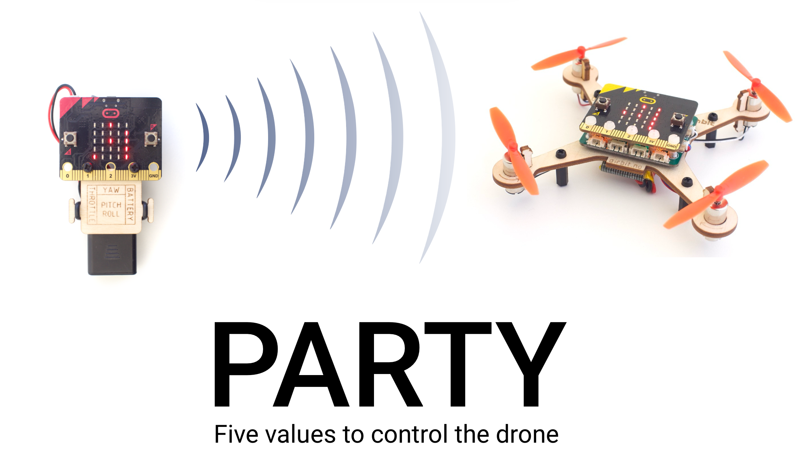

## AirBit Drone project

- C/C++ code based on micro-tools framework: https://github.com/c272/micro-tools 
- Documentation: https://microbit.c272.org
- Hardware: 2x Microbit v2 micro controllers: [Link to Microbit documentation](microbit-v2/README.md)

### Domains

- Hand controller: Defining control inputs and visualize on display
- AirBit Drone: Detect and fly based on input



PARTY: Pitch, arm, roll, throttle, yaw

### Setup
There are some dependancies needed: 
- GCC
- Python 3
- CMake
- GCC ARM EABI
- GCC ARM binutils
- GCC ARM newlib
- GCC ARM libstdc++

This can be done via brew: 
```console
brew install cmake python3
brew install --cask gcc-arm-embedded
```

```console
./microinstall.sh

// ADD micro-tools to PATH: 
echo 'source /Users/geirolatvinnereim/AirBit/aliases.sh' >> ~/.bashrc
source ~/.bashrc

. aliases.sh
./microbuild.sh BUILD_DIRECTORY=./src
```

or you can edit aliases.sh, such that you can use the microbuild command directly: 

```console
alias microbuild="/Users/geirolatvinnereim/AirBit/microbuild.sh BUILD_DIRECTORY=./src"
```

**codal.json: **

the microbuild codal.json file contains the base build configurations used in the build.py python script. Uppon running microbuild.py, the codal.json inside microbit-v2-sdk is symlinked to microbuild/codal.json. In other words, the sdk points to the base config json.

The configuration json contains several build configurations, such as: 
```console
"config":{
        "DEVICE_DMESG": 0,
        "DMESG_SERIAL_DEBUG": 0,
        "CODAL_DEBUG": 0,
        "NO_BLE": 1,
        "MICROBIT_BLE_ENABLED" : 0,
        "MICROBIT_BLE_PAIRING_MODE": 0,
        "CONFIG_MICROBIT_ERASE_USER_DATA_ON_REFLASH": 1
    }
```

### Usage

- microinstall: fetching the lastest microbit v2 sdk into repository and building the source

- microbuild: Building the repository you call the command from into the sdk. Symlink source files and codal.json into sdk. Source code and configuration is up to date before calling build.py
  1. Import config.sh with arguments and parse arguments
  2. Write updated config to codal.json
  3. Symlink source folder and codal.json to sdk
  4. run build script: python3 build.py

- microflash: Making mnt folder with flashed output. NB! microbit must be connected.

- setup:
  
Feed in filepath to microbit-v2-sdk: /Users/geirolatvinnereim/AirBit/microbit-v2-sdk


### Troubleshooting

If nrf_sdh_soc_init() cannot be found. You have called build from a wrong folder. Chech microbit-v2-sdk/source and assure that only the src/.cpp files are present.

If there are build errors in the Codal SDK. There are probably some conflicting file names or methods which causes build errors. Delete the **build** folder produced in /microbit-v2-sdk and rebuild.

### Debugging

In order allow debugging, the project needs to be built by navigating into the microbit-v2-sdk and access debugger inside Visual Studio Code.

```console
python3 build.py
```

### Serial debugging using screen (putty on windows)

You can debug the code by writing information to uBit.serial. E.g

```console
uBit.serial.printf("pitchDps: %d rollDps: %d yawDps: %d\n",
                   state.rollRate, state.pitchRate, state.yawRate);
```

```console
ls /dev/tty.* // Available devices for serial commands
screen /dev/tty.usbmodem144402 115200 // Read serial output using UART
```

NB! The serial print library on the Microbit does not support floating-point format printing. Numbers must be written decimal.

### Linter

We want to utilize a dynamic analysis tool, which can linter codebase, not a static one

Using **clang-format** as dynamic cpp-linter. install and usage:
This command line tool can only linter one file at a time, so we need to apply recursiveness at src
```console
./linter.sh
```